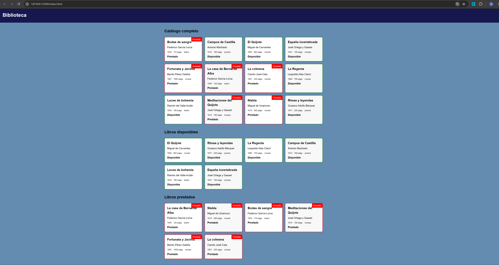
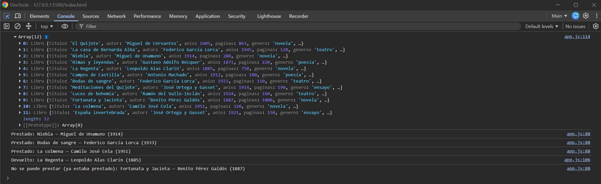
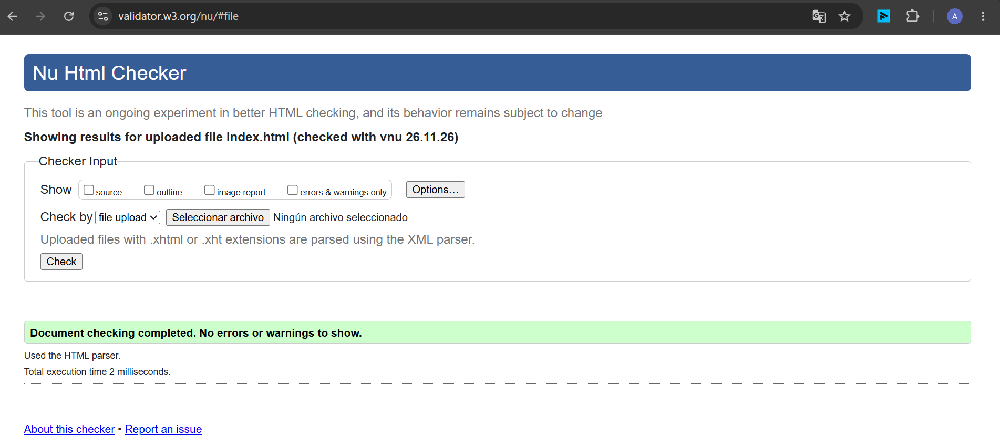

# Proyecto Biblioteca

Web que muestra el catálogo de una biblioteca en varias vistas: catálogo completo, disponibles, prestados, por género, los más antiguos, una búsqueda y estadísticas. Todo lo pinta JavaScript al cargar la página. Proyecto de 2º DAW.

## Arquitectura

Todo el proyecto se ejecuta en el cliente, o sea, en el navegador. El navegador descarga el HTML, el CSS y los archivos JS y es él quien ejecuta el código y dibuja los libros. En un servidor el código se ejecutaría en otro ordenador y al navegador solo le llegaría la página ya hecha. Ahora los préstamos se pierden al recargar la página. Para guardarlos haría falta un servidor con una base de datos, y que la web le enviara cada préstamo y cada devolución.

He usado JavaScript porque es el lenguaje que entienden los navegadores y con él puedo cambiar la página sin instalar nada. Otras tecnologías del cliente son HTML y CSS (que no son lenguajes de programación), TypeScript (que luego se pasa a JavaScript), WebAssembly y frameworks como React o Vue.

Al cargar los scripts como módulos, cada archivo tiene sus propias variables (no son globales) y se pasan lo que necesitan con `export` e `import`. También se cargan más tarde que el HTML. Necesitan un servidor local porque, si abro el HTML con doble clic (`file://`), el navegador no deja cargar módulos por seguridad.

Un lenguaje interpretado como JavaScript se prueba al momento, sin compilar, y funciona en cualquier navegador. Pero es más lento que un programa compilado y los errores salen al ejecutarlo, no antes.

Para programar he usado Visual Studio Code, con Live Server para el servidor local. Para probar y depurar he usado las DevTools del navegador (la consola y `console.table`), y el validador del W3C para comprobar el HTML. Para guardar el proyecto he usado Git y GitHub.

## Decisiones

**Cómo combino los filtros.** Cada filtro me devuelve una lista nueva, así que puedo ir uno detrás de otro. Por ejemplo, para las novelas disponibles ordenadas por páginas, primero ordeno con `ordenarPor("paginas")` y a ese resultado le aplico un `filter` que pide que el género sea novela y que esté disponible.

**Cómo ordeno sin modificar el array original.** `sort()` cambia el array en el que se usa, así que antes hago una copia con `[...this.libros]` y ordeno la copia. De esta forma `this.libros` se queda como estaba. Para textos uso `localeCompare` y para números una resta. Si el orden es descendente, le cambio el signo al resultado.

**Cómo convierto los campos de texto en `cargarDesdeTexto()`.** Todo lo que viene del texto es un string. Primero separo las líneas con `split("\n")` y cada línea en campos con `split(";")`, y limpio los espacios con `trim()`. El año y las páginas los convierto a número con `Number()`. Para el booleano comparo si el último campo es `"si"`, y si lo es, el libro está disponible. Las líneas vacías o que no tienen 6 campos me las salto con `continue`.